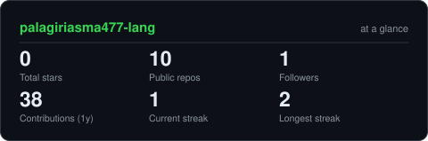
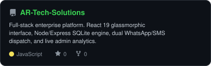
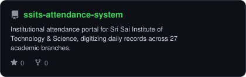
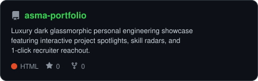
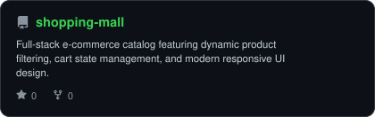

<div align="center">

<!-- PORTRAIT - generated by scripts/dotify.py from assets/portrait.png.
     Colour mode, so one file serves both GitHub themes. Regenerate with:
       python scripts/dotify.py assets/portrait.png -o assets/portrait \
         --cols 100 --equalize --detail 0.5 --color -->


<br>

<!-- NAME / TAGLINE - animated typing -->
<a href="https://github.com/palagiriasma477-lang">
  
</a>

<br>

<!-- SOCIALS -->
<a href="https://raw.githubusercontent.com/palagiriasma477-lang/palagiriasma477-lang/main/PALAGIRI_ASMA_RESUME.doc"></a>
<a href="mailto:palagiriasma477@gmail.com"></a>
<a href="https://wa.me/919390011965"></a>
<a href="https://palagiriasma477-lang.github.io/asma-portfolio/"></a>


</div>

---

## `~/` whoami

```console
$ cat about.txt
```

Hi, I'm **Asma Palagiri**. Full-Stack Software Engineer and Technical Faculty Mentor based in Andhra Pradesh, India. I engineer high-performance web platforms, automate organizational workflows, and translate complex requirements into clean, zero-latency software products.

- Currently building **[AR Tech Solutions](https://github.com/palagiriasma477-lang/AR-Tech-Solutions)** and **[SSITS Attendance System](https://github.com/palagiriasma477-lang/ssits-attendance-system)**
- Portfolio: **[palagiriasma477-lang.github.io/asma-portfolio](https://palagiriasma477-lang.github.io/asma-portfolio/)**
- Mentorship & Background: **2+ Years Technical Lab Mentor at SSITS (trained 120+ students in Full-Stack Web & MySQL) • B.Tech from RGUKT RK Valley (85% Distinction) • M.Tech in CSE (Pursuing)**
- Fun fact: **I love eliminating manual paper workflows with automated real-time systems that never sleep.**

<br>

<div align="center">

## `~/` toolbox


</div>

---

<div align="center">

## `~/` skill radar

<table>
<tr>
<td width="50%" align="center" valign="middle">

<!-- Self-rated radar - edit assets/skills.json, the workflow redraws it -->
<picture>
  <source media="(prefers-color-scheme: dark)"  srcset="assets/radar-dark.svg">
  <source media="(prefers-color-scheme: light)" srcset="assets/radar-light.svg">
  
</picture>

</td>
<td width="50%" align="center" valign="middle">

<!-- Live radar built from real language byte counts across your repos -->
<picture>
  <source media="(prefers-color-scheme: dark)"  srcset="assets/radar-langs-dark.svg">
  <source media="(prefers-color-scheme: light)" srcset="assets/radar-langs-light.svg">
  
</picture>

</td>
</tr>
</table>

</div>

---

<div align="center">

## `~/` contribution calendar

<!-- 3D isometric calendar, regenerated every 6h by .github/workflows/metrics.yml -->


<br><br>

<!-- Snake eats the contribution graph - .github/workflows/snake.yml -->
<picture>
  <source media="(prefers-color-scheme: dark)"  srcset="https://raw.githubusercontent.com/palagiriasma477-lang/palagiriasma477-lang/output/snake-dark.svg">
  <source media="(prefers-color-scheme: light)" srcset="https://raw.githubusercontent.com/palagiriasma477-lang/palagiriasma477-lang/output/snake.svg">
  
</picture>

</div>

---

<div align="center">

## `~/` the numbers

<!-- Generated by scripts/cards.py into this repo. Deliberately NOT
     github-readme-stats / streak-stats / github-profile-trophy: those are
     shared public instances that go down and take the whole section with them. -->
<picture>
  <source media="(prefers-color-scheme: dark)"  srcset="assets/card-stats-dark.svg">
  <source media="(prefers-color-scheme: light)" srcset="assets/card-stats-light.svg">
  
</picture>

<br>


<br><br>


</div>

---

<div align="center">

## `~/` selected work

<!-- Cards generated by scripts/cards.py from assets/projects.json.
     Stars, forks and language are pulled live from the API on every run. -->
<table>
<tr>
<td width="50%">
  <a href="https://github.com/palagiriasma477-lang/AR-Tech-Solutions">
    <picture>
      <source media="(prefers-color-scheme: dark)"  srcset="assets/card-AR-Tech-Solutions-dark.svg">
      <source media="(prefers-color-scheme: light)" srcset="assets/card-AR-Tech-Solutions-light.svg">
      
    </picture>
  </a>
</td>
<td width="50%">
  <a href="https://github.com/palagiriasma477-lang/ssits-attendance-system">
    <picture>
      <source media="(prefers-color-scheme: dark)"  srcset="assets/card-ssits-attendance-system-dark.svg">
      <source media="(prefers-color-scheme: light)" srcset="assets/card-ssits-attendance-system-light.svg">
      
    </picture>
  </a>
</td>
</tr>
<tr>
<td width="50%">
  <a href="https://github.com/palagiriasma477-lang/asma-portfolio">
    <picture>
      <source media="(prefers-color-scheme: dark)"  srcset="assets/card-asma-portfolio-dark.svg">
      <source media="(prefers-color-scheme: light)" srcset="assets/card-asma-portfolio-light.svg">
      
    </picture>
  </a>
</td>
<td width="50%">
  <a href="https://github.com/palagiriasma477-lang/shopping-mall">
    <picture>
      <source media="(prefers-color-scheme: dark)"  srcset="assets/card-shopping-mall-dark.svg">
      <source media="(prefers-color-scheme: light)" srcset="assets/card-shopping-mall-light.svg">
      
    </picture>
  </a>
</td>
</tr>
</table>

<sub>

| project | live / link | stack |
|---|---|---|
| **[AR-Tech-Solutions](https://github.com/palagiriasma477-lang/AR-Tech-Solutions)** | [GitHub Repository](https://github.com/palagiriasma477-lang/AR-Tech-Solutions) | `React 19` `Node.js` `Express` `SQLite` |
| **[ssits-attendance-system](https://github.com/palagiriasma477-lang/ssits-attendance-system)** | [Collaborator Repo](https://github.com/palagiriasma477-lang/ssits-attendance-system) | `JavaScript` `PHP / MySQL` `Bootstrap` |
| **[asma-portfolio](https://github.com/palagiriasma477-lang/asma-portfolio)** | [Live Website](https://palagiriasma477-lang.github.io/asma-portfolio/) | `HTML5` `CSS3 Glassmorphic` `JavaScript` |
| **[shopping-mall](https://github.com/palagiriasma477-lang/shopping-mall)** | [GitHub Repository](https://github.com/palagiriasma477-lang/shopping-mall) | `React` `JavaScript` `CSS Grid` |

</sub>

</div>

---

<div align="center">

<sub>`01110100 01101000 01100001 01101110 01101011 01110011 00100000 01100110 01101111 01110010 00100000 01110011 01100011 01110010 01101111 01101100 01101100 01101001 01101110 01100111`</sub>

</div>
